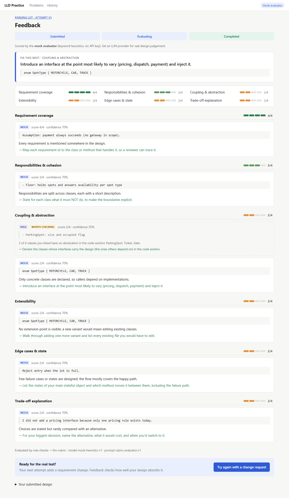
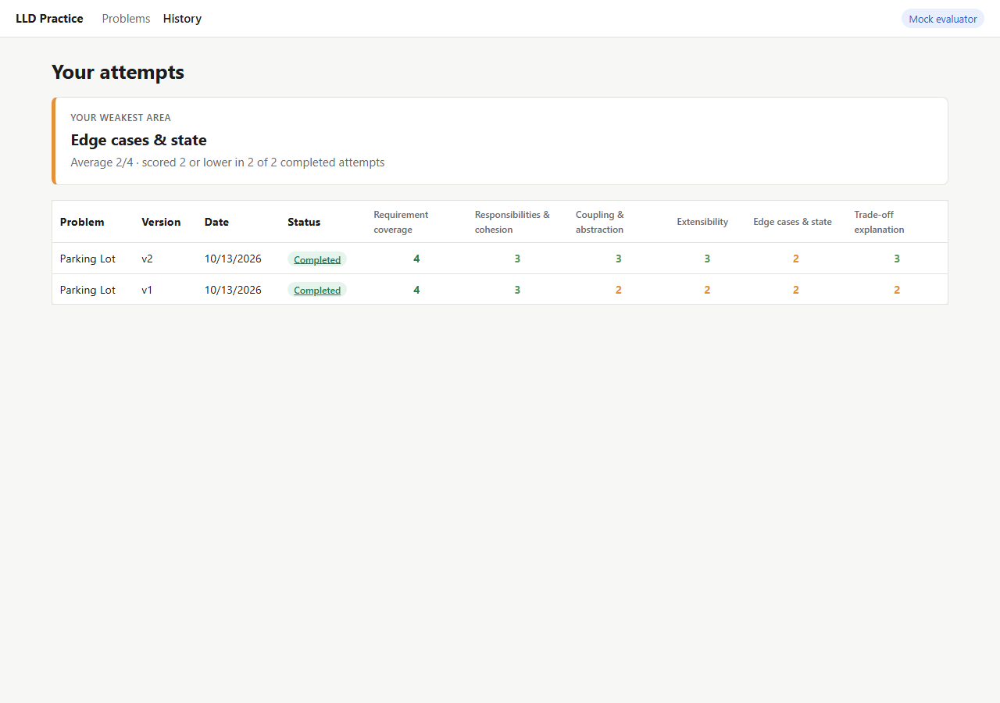
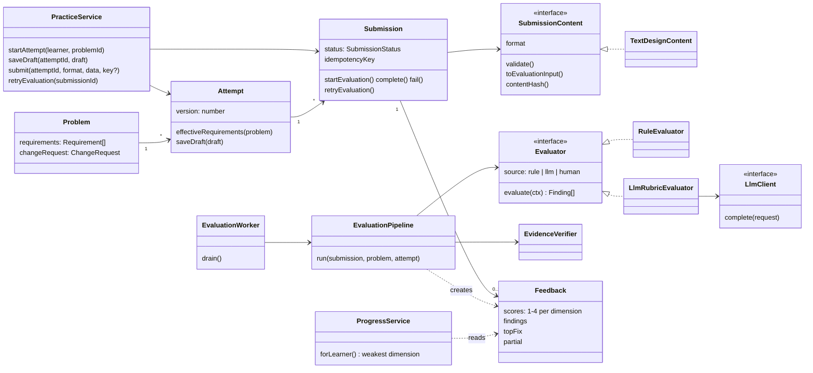
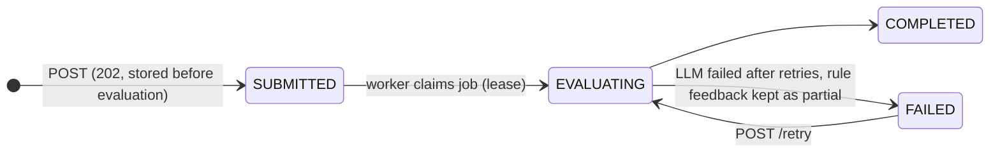

# LLD Practice Platform

Practise Low-Level Design the way it is tested: pick a problem, write a structured design, and get feedback that **scores it against the requirements and a fixed rubric, not one "correct" answer**. Every point quotes your own words, and code drops any point whose quote isn't really in your submission. Your second attempt adds a **requirement change** (e.g. "add EV charging billed per kWh"), because surviving a change is the real LLD skill. History shows which rubric dimension you keep getting wrong.

| Feedback (scores, top fix, quoted findings) | History with weakest area |
|---|---|
|  |  |

More: [problems](docs/screenshots/01-problems.png) · [editor](docs/screenshots/02-editor.png) · [v2 change request](docs/screenshots/04-change-request.png) · [failed with partial feedback](docs/screenshots/07-failed-partial.png). Notes: [Research](docs/research-note.md) · [Design](docs/design-note.md) · [AI usage](AI_USAGE.md).

## Quick start (no API key needed)

```bash
npm install && npm run dev        # API on :3000, UI on http://localhost:5173
npm test                          # 37 tests
npm run build && npm start        # production: everything on http://localhost:3000
```

Requires Node 22.13+ (uses the built-in `node:sqlite`, so there is no native build step). With no configuration it uses the **mock evaluator**: deterministic keyword heuristics behind the real prompt → zod → evidence-check path, labelled "Mock evaluator" in the UI.

**Use a real LLM:** copy `.env.example` to `.env` and set one of:

```bash
LLM_PROVIDER=anthropic  ANTHROPIC_API_KEY=sk-ant-...           # model defaults to claude-sonnet-5-5
LLM_PROVIDER=openai     OPENAI_API_KEY=sk-...  LLM_MODEL=gpt-4.1
```

## Architecture





The practice flow (`PracticeService`, `Attempt`, `Submission`) never knows **which format** was submitted (`SubmissionContent`) or **which evaluator** produced feedback (`Evaluator`). Those are the only two Strategy interfaces. Evaluation is a pipeline: rules first, and a blocking structural finding stops it before the LLM is called. Then the LLM scores the design against the rubric, and `EvidenceVerifier` drops any finding whose quote is not in the submission.

## Key decisions

- **Rubric, not reference answer:** 6 fixed dimensions, scored 1–4 with an anchor sentence per score, plus a per-problem requirement checklist.
- **Evidence or it didn't happen:** findings must quote the submission verbatim, and code verifies the quote. The top fix is chosen by code from verified findings, not written freely by the LLM.
- **Deterministic first:** structure, class/code consistency, god class and keyword gaps are checked by code. Keyword gaps go to the LLM as hints to confirm or reject.
- **Versioned prompt + structured output:** `src/prompts/rubric-evaluator.v1.md`, validated with zod, with one repair retry. Learner text is escaped so it cannot leave `<submission>`.
- **Never lose work:** the submission and its job are stored in one transaction before evaluation. Requests are idempotent, jobs are leased, failures keep partial rule feedback, and the learner can retry.
- **First thing to split out as usage grows: the evaluation worker** (its own process on the same jobs table, then a real queue), because LLM calls are the slow, costly, bursty part.

| Decision | Gain | Cost |
|---|---|---|
| Structured text vs diagrams | Shows reasoning + code-level abstraction; cheap to build | Relationships inferred from text |
| 1–4 rubric vs 100-point score | Repeatable; says what to work on | Coarse; small gains don't move a score |
| Drop unquoted findings | No invented criticism | Correct paraphrased points are lost |
| SQLite as job queue | Survives restarts, zero infra | Single process; up to 2 s polling latency |
| Transition table vs State pattern | All legal moves in one place | Retry-from-FAILED needs one explicit rule |
| Mock evaluator by default | Zero-setup demo; exercises the whole pipeline | Heuristics, not real judgement |

## The design questions

1. **What must a learner provide?** Five sections: requirements and assumptions, classes and responsibilities, key interfaces as code, main flow, and trade-offs. Each has a minimum length, enforced with a 400 that lists every incomplete section.
2. **Useful feedback when many designs are valid?** Judge against requirements + rubric anchors, never a model answer. Give a score per dimension, findings that quote the learner's own text, and one fix to do next.
3. **Deterministic vs LLM?** Code checks anything with one right answer: structure, lengths, declared types, method counts, keyword presence, state transitions and idempotency. The LLM judges design quality and confirms or rejects the rule hints.
4. **New evaluation approach or format?** Implement `Evaluator` or `SubmissionContent` and register it. Change tests A and B do exactly this in code.
5. **Slow or failing evaluation?** 202 plus a background worker, a 60 s timeout with 2 retries, leases, partial feedback, and a manual retry (see the state diagram above).

## Change tests (`tests/change-tests.test.ts`)

| Change | Added | Untouched |
|---|---|---|
| **A**: class-diagram submissions | `FakeDiagramContent implements SubmissionContent` + 1 registry line | Attempt, Submission, PracticeService, pipeline, evaluators, worker, DB schema |
| **B**: human/rule reviewer | `FakeHumanEvaluator implements Evaluator` + 1 list entry | PracticeService, worker, Submission, Feedback (findings carry `source: "human"`) |

## Limitations and next steps

- Keyword coverage is crude: synonyms are missed and substrings can match, so it only produces low-confidence hints.
- LLM scores can still vary slightly between runs; temperature 0 isn't available on current Claude models, so consistency relies on anchors, the schema and code-side scoring.
- One demo learner, no auth. Repositories are synchronous (Node's built-in `node:sqlite`).
- **Next:** a small eval set of real designs to calibrate the prompt; human review as a third evaluator; diagram input; per-requirement traceability in feedback.

## Project structure

```
src/domain/          pure domain: Problem, Attempt, Submission, content + evaluation interfaces, pipeline, Feedback, progress
src/evaluators/      RuleEvaluator, LlmRubricEvaluator (zod + repair), EvidenceVerifier
src/llm/             LlmClient + Anthropic / OpenAI / mock clients, timeout+retry helper
src/prompts/         rubric-evaluator.v1.md (versioned prompt) + builder
src/infra/           SQLite migrations, repositories, job queue; JSON problem repository
src/worker/          EvaluationWorker (lease-based, in-process)
src/api/             Express routes, DTOs, error mapping   ·  src/container.ts: composition root
src/data/problems/   4 seeded problems with requirements + change requests
web/                 React + Vite UI
tests/               Vitest: domain, evaluators, worker failure paths, change tests, API e2e
```

API: `GET /api/problems[/:id]` · `POST /api/attempts` · `GET /api/attempts/:id` · `PUT /api/attempts/:id/draft` · `POST /api/attempts/:id/submissions` (`Idempotency-Key`; 202/200/400) · `GET /api/submissions/:id` · `POST /api/submissions/:id/retry` · `GET /api/history[?problemId=]`. Errors are always `{ error: { code, message, details? } }`.
