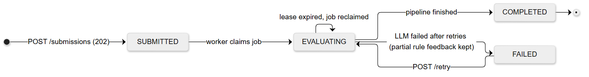
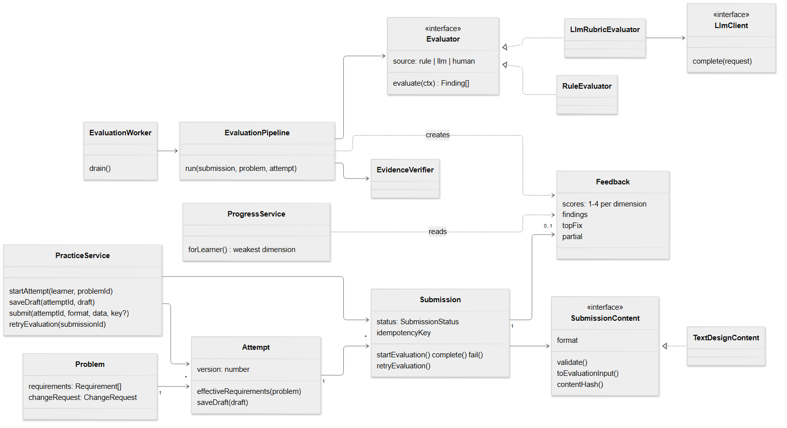

# Design Note: LLD Practice Platform

A TypeScript monolith (Express + SQLite + React). The domain layer (`src/domain`) has no framework, SQL or LLM code. Everything below describes what is in the repository.

## 1. MVP scope

| In | Out (deliberately) |
|------|----|
| 4 problems, each with 6 requirements, constraints and one change request | Auth (one demo learner) |
| Attempt editor: 5 structured sections, autosaved draft | Diagram editor, running learner code |
| Async evaluation: rules → LLM → evidence check → 1–4 per dimension | Timers, peer review, courses |
| Status: Submitted → Evaluating → Completed / Failed, manual retry | Multi-user scaling, real queue |
| Retry as v2 with the change request; history with weakest dimension | Analytics beyond the weakest dimension |

## 2. User flow and status

Choose problem → write 5 sections (autosaved) → submit (stored, 202) → background evaluation → feedback (scores, top fix, quoted findings) → **try again as v2 with a change request** → history shows both attempts and the weakest dimension.



## 3. Domain model



| Class | Single responsibility |
|--|--------|
| `Problem` | Requirements (id, text, keywords), constraints, one change request. |
| `Attempt` | One try at a problem. `version` ≥ 2 adds the change request in `effectiveRequirements()`. Holds the draft. |
| `Submission` | Immutable content snapshot + status. Owns legal moves via a transition table; idempotency key = `attemptId:contentHash`. |
| `SubmissionContent` | What was submitted, in some format. Validates itself and maps to `EvaluationInput`. |
| `Evaluator` | Turns an `EvaluationContext` into `Finding[]` (rule, LLM, or later human). |
| `EvaluationPipeline` | Runs evaluators in order, stops on a blocking finding, verifies quotes, builds `Feedback`. |
| `Feedback` | Per-dimension 1–4 scores, findings, `topFix`, `partial`, `model`, `promptVersion`. One per submission. |
| `PracticeService` | The practice loop: start attempt, save draft, submit, retry. Knows no formats or evaluators. |
| `EvaluationWorker` | Claims jobs, runs the pipeline, stores feedback and the final status. |
| `ProgressService` | Averages each attempt's latest completed feedback; returns the weakest dimension. |

The two variation points sit behind two interfaces:

```ts
interface SubmissionContent {
  readonly format: string;                 // "text-design" today, "class-diagram" later
  validate(): ValidationResult;            // deterministic, at submit time
  toEvaluationInput(): EvaluationInput;    // sections by role: the one shape evaluators read
  contentHash(): string;                   // part of the idempotency key
  toJSON(): unknown;                       // persisted; rebuilt via ContentFormatRegistry
}

interface Evaluator {
  readonly source: "rule" | "llm" | "human";
  readonly name: string;
  readonly provenance?: { model: string; promptVersion: string };
  evaluate(ctx: EvaluationContext): Promise<Finding[]>;
  // ctx = { input, problem, attempt, requirements, priorFindings }
}

type Finding = {
  criterion: RubricDimension; score: 1 | 2 | 3 | 4;
  evidence: string | null;   // verbatim quote; null only for rule "nothing mentions X"
  concern: string; suggestion: string;
  confidence: number;        // < 0.5 = "worth checking", does not move the score
  source: "rule" | "llm" | "human"; blocking?: boolean;
};
```

**Why only Strategy and a pipeline.** Patterns appear only where something varies. Submission formats and evaluators vary, so each is a Strategy. Evaluation is an ordered sequence with a short-circuit, so it is a pipeline. Submission status is a **transition table, not the State pattern**: the states have no behaviour of their own, only rules about which state may follow which. One rule sits outside the table: `retryEvaluation()` is allowed only from FAILED. A test caught that the table alone would let a retry jump a SUBMITTED submission.

## 4. Evaluation approach

| Deterministic (`RuleEvaluator`, at submit time and first in the pipeline) | LLM (`LlmRubricEvaluator`) |
|---|---|
| All 5 sections present, min/max length → 400 with per-section messages | Quality of responsibilities, coupling, abstraction |
| Code declares no class/interface/enum → **blocking**: LLM is never called | Whether a requirement is really handled (confirms or rejects keyword hints) |
| Classes listed in prose but missing from code → finding with quote | How well the change request was absorbed |
| God class: ≥ 8 methods and ≥ 2× the median | Edge cases, states, trade-off reasoning |
| Requirement keywords absent → "possible gap" hint (confidence 0.35) | Concrete suggestions naming a class or method |
| v2+: change-request keywords absent → finding (0.6) | |

**Rubric.** Six fixed dimensions: requirement coverage, responsibilities & cohesion, coupling & abstraction, extensibility (on v2+: absorbing the change), edge cases & state, trade-off explanation. Each has an anchor sentence for every score from 1 (missing) to 4 (strong); see `src/domain/evaluation/rubric.ts`. A dimension's score is the confidence-weighted mean of its findings with confidence ≥ 0.5. The **top fix is chosen by code**: a blocking finding first, otherwise the lowest-scored confident finding. This keeps it pointing at a verified quote rather than at free text from the LLM.

**Prompt** (`src/prompts/rubric-evaluator.v1.md`, versioned):

- Role: a senior engineer reviewing an LLD interview answer. "Many designs are valid; judge against requirements and anchors, never a model answer."
- Inputs are XML-tagged: `<problem>`, `<requirements>` (the change request is marked), `<rubric>`, `<rule_findings>` (hints to confirm or reject), and `<submission>` (sections tagged by role).
- Output: JSON only, 1–3 findings per dimension. Evidence is a verbatim quote of at most 200 characters. The prompt includes one worked example (hard-wired parking pricing → inject a `PricingStrategy`).
- **Injection defence:** the submission is declared to be data, and its instructions must never be followed. Delimiter tags typed by the learner are escaped, so injected text cannot leave `<submission>`.

**Guards on AI output.** Output is parsed and validated with zod (every dimension must be present). If that fails, one **repair retry** sends the error back; a second failure throws. **`EvidenceVerifier`** normalises case, whitespace and quote marks, then drops any finding whose evidence is not a substring of the submission (or is shorter than 8 characters), and the drop count is logged and shown. `model` and `promptVersion` are stored with every Feedback.

**Providers.** `LLM_PROVIDER=mock|anthropic|openai`, defaulting to mock when no key is set.

- The mock parses the real prompt and quotes real sentences, so mock mode exercises the whole pipeline.
- Anthropic uses the official SDK with structured output.
- *Deviation from the brief:* no `temperature: 0` for Anthropic, because current Claude models reject non-default sampling. OpenAI gets `temperature: 0`.

## 5. Slow or failed evaluation

- `POST /attempts/:id/submissions` validates, then stores the submission (SUBMITTED) and its job **in one transaction**, and returns **202** before any evaluation.
- **Idempotency:** `Idempotency-Key` (the UI sends `attemptId:sha256(content)`, the server's own default). A repeat returns the original with 200.
- **Worker:** an in-process loop polls the `evaluation_jobs` table every 2 s. A claim sets `lease_until`. Jobs survive restarts, and a job whose lease has expired is reclaimed.
- **LLM calls:** each call has a 60 s timeout and 2 retries with exponential backoff (1 s, 2 s). Errors that won't fix themselves (401, 400, refusal) are not retried. The lease covers the worst case: two calls with all retries.
- **Failure:** the submission becomes FAILED with a `failureReason`. The rule findings are kept as Feedback with `partial: true`. `POST /submissions/:id/retry` (FAILED only, else 409) re-queues it.
- **Polling:** the UI polls `GET /submissions/:id` every 3 s.
- **Growth:** the first component to separate is the worker (its own process on the same jobs table, then a real queue), because LLM calls are the slow, costly and bursty part.

## 6. Change tests (both run as code in `tests/change-tests.test.ts`)

| | Added | Untouched |
|----|------|------|
| **A**: learner submits a class diagram | `FakeDiagramContent implements SubmissionContent` (maps boxes and arrows to section roles) + one `registry.register("class-diagram", …)` line | Attempt, Submission, PracticeService, pipeline, evaluators, worker, DB schema (content is stored as format + JSON) |
| **B**: rule-based or human evaluator | `FakeHumanEvaluator implements Evaluator` + one entry in the evaluator list | PracticeService, worker, Submission, Feedback; findings show `source: "human"` |

## 7. Trade-offs and limitations

| Decision | Gain | Cost |
|---|---|---|
| Structured text, not diagrams | Shows reasoning and code-level abstraction; cheap to build | Relationships are inferred from text |
| 1–4 per dimension with anchors, not a 100-point score | Repeatable, tells the learner what to work on | Coarse; small improvements don't move a score |
| Drop findings whose quote isn't found | No invented criticism; every point is checkable | Correct but paraphrased points are lost |
| SQLite table as the job queue | Survives restarts, zero infrastructure | One process; polling latency up to 2 s |
| Transition table, not State pattern | All legal moves in one place | Retry needs one extra explicit rule |
| Mock evaluator by default | Runs with zero setup; tests the whole pipeline | Keyword heuristics, not real judgement |

**Limitations.**

- Keyword coverage is crude: synonyms are missed and substrings can match, which is why it only produces low-confidence hints.
- LLM scores can still vary slightly between runs.
- There is one demo learner.
- Repositories are synchronous (Node's built-in `node:sqlite`).
- **Next:** an eval set of real designs to calibrate the prompt, human review as a third evaluator, diagram input, and per-requirement traceability in feedback.
